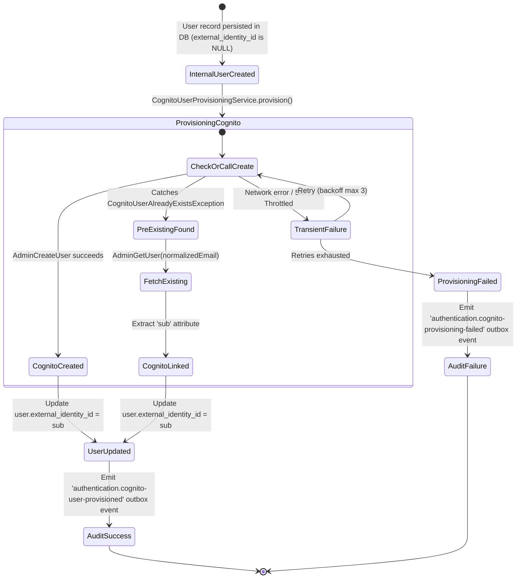

# Data Model: AWS Cognito Account Provisioning on User Creation

**Feature Branch**: `029-create-cognito-user`  
**Date**: 2026-10-16  

---

## Entities & Data Relationships

### 1. User Entity (`users` table)

The core internal representation of an identity account within a tenant.

| Field Name | Type | Constraints | Description |
|---|---|---|---|
| `id` | `UUID` | PK, Not Null | Unique internal user identifier |
| `tenant_code` | `VARCHAR(50)` | Not Null, FK -> `tenants(tenant_code)` | Tenant code scoping the user |
| `employee_ref_id` | `UUID` | Nullable, Unique | Reference to the associated workforce employee |
| `normalized_email` | `VARCHAR(320)` | Not Null | Lowercased, whitespace-trimmed email address |
| `display_email` | `VARCHAR(320)` | Not Null | User-facing display email address |
| `user_type` | `VARCHAR(30)` | Not Null | User type (e.g., `admin`, `employee`, `contractor`) |
| `status` | `VARCHAR(30)` | Not Null | Account status (`ACTIVE`, `INACTIVE`, `DISABLED`, `ARCHIVED`) |
| `credential_status` | `VARCHAR(30)` | Not Null | Credential state (`PENDING`, `SET`, `EXPIRED`) |
| `security_version` | `INTEGER` | Not Null, Default `1` | Incrementing version for token invalidation |
| `protected_root_admin` | `BOOLEAN` | Not Null, Default `FALSE` | Flag for protected built-in administrator |
| `external_identity_id` | `VARCHAR(100)` | Nullable | **Stores the AWS Cognito `sub` identifier** |
| `created_at` | `TIMESTAMPTZ` | Not Null, Default `NOW()` | Record creation timestamp |
| `updated_at` | `TIMESTAMPTZ` | Not Null, Default `NOW()` | Record last update timestamp |
| `deleted_at` | `TIMESTAMPTZ` | Nullable | Soft-delete timestamp |
| `version` | `INTEGER` | Not Null, Default `1` | Optimistic lock version |

---

### 2. External Cognito Directory Representation (`CognitoUserRecord`)

In-memory representation returned by `@new-hros/libs-aws` `CognitoService`.

| Field Name | Type | Description |
|---|---|---|
| `username` | `string` | The Cognito username (set to `normalized_email`) |
| `attributes` | `Record<string, string>` | Key-value pairs including `sub`, `email`, `email_verified`, `custom:tenant_code` |
| `enabled` | `boolean` | Account active status in Cognito User Pool |
| `userStatus` | `CognitoUserStatus` | Cognito status (`FORCE_CHANGE_PASSWORD`, `CONFIRMED`, `UNCONFIRMED`, etc.) |
| `userCreateDate` | `Date` | Timestamp of user creation in AWS Cognito |
| `userLastModifiedDate` | `Date` | Timestamp of last modification in AWS Cognito |

---

### 3. Security Audit Event (`auth_security_events_outbox`)

Outbox record published to downstream Kafka consumers for security auditing.

| Event Type | Envelope Attributes | Payload Attributes | Trigger Condition |
|---|---|---|---|
| `authentication.cognito-user-provisioned` | `eventId`, `tenantCode`, `eventType`, `timestamp` | `userId`, `normalizedEmail`, `externalIdentityId`, `action: 'CREATED' \| 'LINKED_EXISTING'` | Dispatched upon successful creation or linking of Cognito user |
| `authentication.cognito-provisioning-failed` | `eventId`, `tenantCode`, `eventType`, `timestamp` | `userId`, `normalizedEmail`, `errorCode`, `reason`, `retryCount` | Dispatched when external Cognito provisioning exhausts retries and fails |

---

## State Transition Diagram

