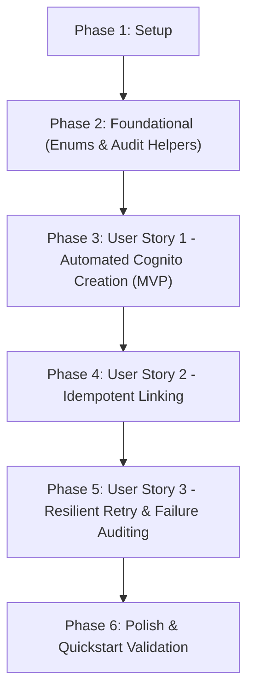

# Tasks: AWS Cognito Account Provisioning on User Creation

**Input**: Design documents from `specs/029-create-cognito-user/` (`spec.md`, `plan.md`, `data-model.md`, `research.md`, `contracts/`, `quickstart.md`)

**Prerequisites**: `plan.md` (required), `spec.md` (required for user stories), `research.md`, `data-model.md`, `contracts/`

**Tests**: Unit tests are included for each user story in accordance with the project constitution (Constitution Principle V: TDD & Quality Gates).

**Organization**: Tasks are grouped by user story to enable independent implementation and testing of each story in priority order (P1 -> P2 -> P2).

## Format: `- [ ] [TaskID] [P?] [Story?] Description with file path`

- **[P]**: Can run in parallel (different files, no dependencies)
- **[Story]**: Which user story this task belongs to (`US1`, `US2`, `US3`)
- Descriptions include exact file paths.

---

## Phase 1: Setup (Shared Infrastructure & Types)

**Purpose**: Module configuration, interface contracts, and domain exceptions.

- [X] T001 [P] Configure and export `CognitoModule` access in `src/modules/user/user.module.ts`
- [X] T002 [P] Define `ProvisionCognitoUserInput` and `CognitoProvisioningResult` interfaces in `src/modules/user/interfaces/cognito-provisioning.interface.ts`
- [X] T003 [P] Create `CognitoProvisioningException` domain exception in `src/modules/user/domain/exceptions/cognito-provisioning.exception.ts`

---

## Phase 2: Foundational (Blocking Prerequisites)

**Purpose**: Event enum registration and outbox audit helpers required across all user stories.

**⚠️ CRITICAL**: No user story work can begin until this phase is complete.

- [X] T004 [P] Add `AUTHENTICATION_COGNITO_USER_PROVISIONED` and `AUTHENTICATION_COGNITO_PROVISIONING_FAILED` enum values in `src/enums/event-type.enum.ts`
- [X] T005 [P] Implement `logCognitoUserProvisioned` and `logCognitoProvisioningFailed` in `src/modules/security-event/services/security-event.service.ts`
- [X] T006 [P] Add unit tests for `logCognitoUserProvisioned` and `logCognitoProvisioningFailed` in `src/modules/security-event/services/security-event.service.spec.ts`

**Checkpoint**: Foundation ready - User story implementations can now begin.

---

## Phase 3: User Story 1 - Automated Cloud Identity Provisioning on User Creation (Priority: P1) 🎯 MVP

**Goal**: Automatically provision a matching user identity in AWS Cognito User Pool when an internal user is created, store the returned Cognito `sub` in `user.externalIdentityId`, and emit the security outbox event.

**Independent Test**: Can be fully tested by creating an internal user (e.g. via `ProvisioningApplicationService.bootstrapRootAdmin`), verifying that `CognitoService.createUser` is invoked with mapped attributes (`email`, `email_verified`, `custom:tenant_code`) and `messageAction: 'SUPPRESS'`, `user.externalIdentityId` is updated in PostgreSQL, and an outbox event `authentication.cognito-user-provisioned` is written.

### Tests for User Story 1

- [X] T007 [P] [US1] Unit test for `CognitoUserProvisioningService.provisionCognitoUser` successful provisioning and attribute mapping in `src/modules/user/services/cognito-user-provisioning.service.spec.ts`
- [X] T008 [P] [US1] Unit test for `ProvisioningApplicationService.bootstrapRootAdmin` integrating Cognito provisioning in `src/modules/provisioning/services/provisioning.application.service.spec.ts`

### Implementation for User Story 1

- [X] T009 [US1] Implement `CognitoUserProvisioningService` in `src/modules/user/services/cognito-user-provisioning.service.ts` with normalized email mapping, tenant attribute setting, and `userRepository` update
- [X] T010 [US1] Register `CognitoUserProvisioningService` in `UserModule` providers and exports in `src/modules/user/user.module.ts` and barrel exports in `src/modules/user/index.ts`
- [X] T011 [US1] Call `CognitoUserProvisioningService.provisionCognitoUser` inside `ProvisioningApplicationService.bootstrapRootAdmin` in `src/modules/provisioning/services/provisioning.application.service.ts`
- [X] T012 [US1] Append `authentication.cognito-user-provisioned` outbox event with `action: 'CREATED'` in `src/modules/user/services/cognito-user-provisioning.service.ts`

**Checkpoint**: User Story 1 is fully functional and delivers independent MVP value for automatic cloud identity provisioning upon user creation.

---

## Phase 4: User Story 2 - Idempotent Identity Linking for Pre-Existing Cloud Accounts (Priority: P2)

**Goal**: Gracefully intercept `CognitoUserAlreadyExistsException` when an account with the specified email already exists in AWS Cognito, fetch the existing Cognito user record via `CognitoService.getUser`, and link `externalIdentityId` without failing user creation.

**Independent Test**: Can be tested by invoking `CognitoUserProvisioningService.provisionCognitoUser` when `CognitoService.createUser` throws `CognitoUserAlreadyExistsException`, asserting that `CognitoService.getUser` is invoked, `user.externalIdentityId` is linked, and the outbox event indicates `action: 'LINKED_EXISTING'`.

### Tests for User Story 2

- [X] T013 [P] [US2] Unit test for `CognitoUserProvisioningService` verifying interception of `CognitoUserAlreadyExistsException` and linking existing `sub` in `src/modules/user/services/cognito-user-provisioning.service.spec.ts`

### Implementation for User Story 2

- [X] T014 [US2] Update `CognitoUserProvisioningService.provisionCognitoUser` to catch `CognitoUserAlreadyExistsException`, call `CognitoService.getUser`, and update `user.externalIdentityId` in `src/modules/user/services/cognito-user-provisioning.service.ts`
- [X] T015 [US2] Append `authentication.cognito-user-provisioned` outbox event with `action: 'LINKED_EXISTING'` in `src/modules/user/services/cognito-user-provisioning.service.ts`

**Checkpoint**: User Stories 1 and 2 work seamlessly; duplicate/pre-existing accounts are idempotently linked without error.

---

## Phase 5: User Story 3 - Resilient Failure Handling and Transaction Consistency (Priority: P2)

**Goal**: Implement exponential backoff retry for transient network/server/throttling errors, log security audit events on permanent failure with zero plain secrets, and maintain transaction consistency.

**Independent Test**: Can be tested by simulating transient failures and asserting exponential retries occur; simulating permanent external failure and asserting that `CognitoProvisioningException` is thrown, `authentication.cognito-provisioning-failed` outbox event is logged, and zero credentials appear in logs.

### Tests for User Story 3

- [X] T016 [P] [US3] Unit test for exponential backoff retries and permanent failure event emission in `src/modules/user/services/cognito-user-provisioning.service.spec.ts`

### Implementation for User Story 3

- [X] T017 [US3] Implement retry mechanism with exponential backoff (up to 3 attempts for transient network/5xx/throttling errors) in `src/modules/user/services/cognito-user-provisioning.service.ts`
- [X] T018 [US3] Implement permanent failure handling to emit `authentication.cognito-provisioning-failed` outbox event and throw typed `CognitoProvisioningException` in `src/modules/user/services/cognito-user-provisioning.service.ts`

**Checkpoint**: All user stories are implemented, resilient against external disruptions, and fully audited.

---

## Phase 6: Polish & Cross-Cutting Concerns

**Purpose**: Verification, linting, formatting, and quickstart scenario validation across the codebase.

- [X] T019 [P] Run linter and formatting checks via `pnpm lint` and `pnpm format` across all new and modified files
- [X] T020 Run unit test suites via `pnpm test -- src/modules/user src/modules/provisioning src/modules/security-event`
- [X] T021 Validate end-to-end functionality against scenarios in `specs/029-create-cognito-user/quickstart.md`

---

## Dependencies & Execution Order

### Phase Dependencies

- **Setup (Phase 1)**: No dependencies - can start immediately
- **Foundational (Phase 2)**: Depends on Setup completion - BLOCKS all user stories
- **User Story 1 (Phase 3)**: Depends on Phase 2 completion (MVP)
- **User Story 2 (Phase 4)**: Depends on Phase 3 (extends `CognitoUserProvisioningService` with idempotency)
- **User Story 3 (Phase 5)**: Depends on Phase 3 & 4 (adds resilient retry and failure auditing)
- **Polish (Phase 6)**: Depends on all user stories completion

### User Story Completion Order

### Parallel Opportunities

- Within Phase 1: T001, T002, T003 can execute in parallel
- Within Phase 2: T004, T005, T006 can execute in parallel
- Within Phase 3: Tests T007, T008 can be written in parallel before implementation
- Within Phase 4: Test T013 can be written in parallel before implementation
- Within Phase 5: Test T016 can be written in parallel before implementation
- Within Phase 6: T019 can run in parallel with review

---

## Implementation Strategy

### MVP First (User Story 1 Only)

1. Complete Phase 1: Setup (`src/modules/user/interfaces/`, `src/modules/user/domain/exceptions/`)
2. Complete Phase 2: Foundational (`src/enums/event-type.enum.ts`, `src/modules/security-event/`)
3. Complete Phase 3: User Story 1 (`CognitoUserProvisioningService`, integration in `ProvisioningApplicationService`)
4. **VALIDATE**: Run `pnpm test -- src/modules/user src/modules/provisioning`
5. At this stage, new users automatically get accounts in AWS Cognito and have `externalIdentityId` set.

### Incremental Delivery

1. Foundation ready (Phase 1 + 2)
2. Deliver US1 (Core automated creation MVP)
3. Deliver US2 (Idempotent linking for existing accounts)
4. Deliver US3 (Backoff retries and failure outbox events)
5. Final polish, lint, and quickstart validation (Phase 6)
